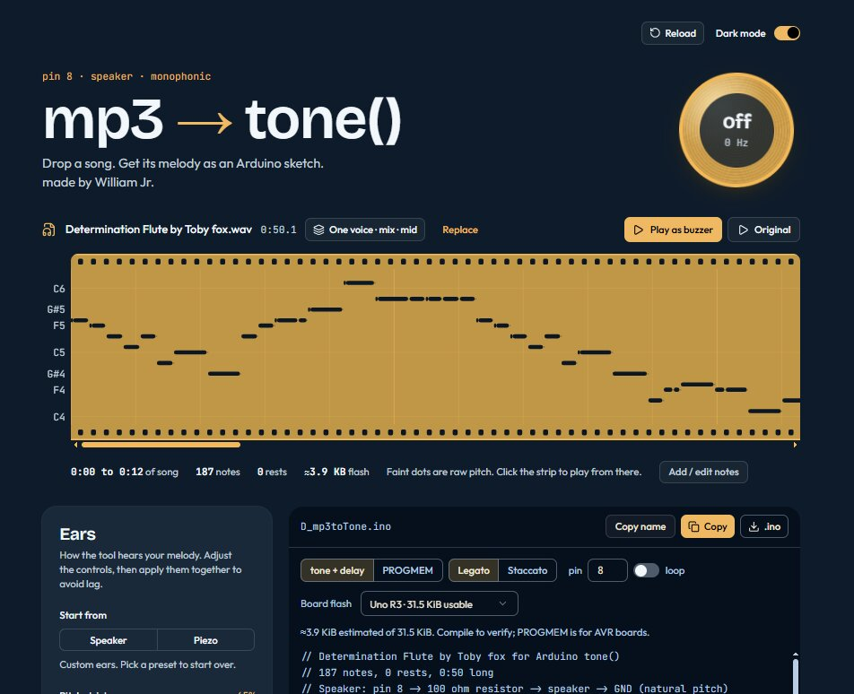

# PiezoPlay

A beginner-friendly tool for turning MP3, MIDI, and MusicXML into Arduino piezo-buzzer code.

[Open PiezoPlay](https://yuuhipro.github.io/PiezoPlay/)

## Screenshot

No install needed. Import a music file, edit and preview the notes, then export Arduino code for a piezo buzzer.

## Features

- Convert MP3 audio into an editable melody
- Import MIDI and MusicXML files
- Preview and edit notes and timing
- Export Arduino C++ code using `tone()`

## Limitations

Arduino’s `tone()` function plays one note at a time, so full songs with chords, vocals, and multiple instruments may not convert cleanly. Clear, single-note melodies work best.

“Determination” from *Undertale*, composed by Toby Fox. Flute arrangement by Eliaz Bobadilla, shared by [UltiMusic Center on YouTube](https://www.youtube.com/watch?v=Myho5X5-F50).

PiezoPlay is an independent fan-made tool and is not affiliated with or endorsed by Toby Fox.
